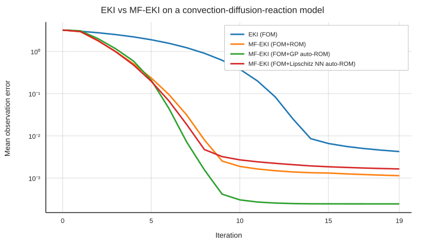

Convection-diffusion-reaction EKI and MF-EKI
============================================

**Method.** Ensemble Kalman inversion (EKI) estimates unknown parameters from observations using an ensemble of model evaluations. Multifidelity EKI adds cheaper surrogate evaluations.

**Example.** The example infers diffusion and reaction parameters in a steady convection-diffusion-reaction model, comparing full-order EKI with projection-ROM, Gaussian-process, and neural-network multifidelity variants.

Run: ``python examples/eki_mf_eki_demo/example.py``.

   Observation error across EKI variants.

For algorithm details, settings, and full source listings, see
:doc:`eki_mf_eki_demo_details`.

.. toctree::
   :hidden:

   eki_mf_eki_demo_details
